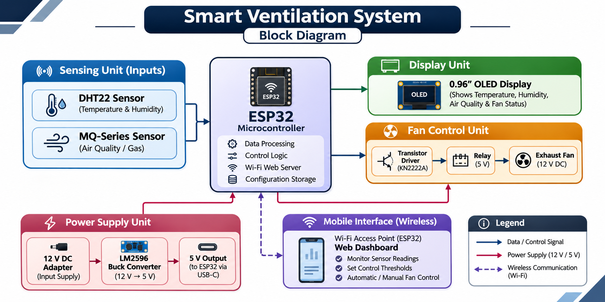

# Smart Ventilation System

**Automatic exhaust fan control with air monitoring and mobile connectivity**

An ESP32-based ventilation prototype that monitors temperature, humidity and gas-sensor readings, then switches an exhaust fan automatically or on demand. Live readings appear on a 0.96-inch OLED and on a Wi-Fi dashboard that opens from any phone.

> **Prototype note:** MQ sensor readings in this project are raw ADC counts. They are not calibrated ppm values, AQI measurements or a certified gas/safety alarm.

## Contents

- [Overview](#overview)
- [Features](#features)
- [Hardware](#hardware)
- [System block diagram](#system-block-diagram)
- [Pin connections](#pin-connections)
- [Power arrangement](#power-arrangement)
- [Software requirements](#software-requirements)
- [Upload and run](#upload-and-run)
- [Operating logic](#operating-logic)
- [Repository structure](#repository-structure)
- [Limitations and future work](#limitations-and-future-work)
- [Safety](#safety)
- [Project information](#project-information)

## Overview

The ESP32 reads a DHT22 temperature/humidity sensor and an MQ-series gas sensor. Based on configurable thresholds, it switches a 12 V DC exhaust fan through a 5 V relay driven by a KN2222A transistor. Sensor values and fan status are shown on the OLED and on the ESP32's local Wi-Fi dashboard.

## Features

- Temperature and humidity monitoring with a DHT22
- Gas/air monitoring with an MQ-series module
- Automatic fan control with hysteresis to reduce rapid switching
- Automatic and manual operating modes
- 0.96-inch I²C OLED status display
- ESP32 Wi-Fi access point with a mobile-friendly web dashboard
- Adjustable temperature and gas raw-reading thresholds
- Threshold settings stored in ESP32 non-volatile memory

## Hardware

| Component | Purpose |
|---|---|
| ESP32 DevKit (ESP32-WROOM-32) | Main controller and Wi-Fi access point |
| DHT22 / AM2302 | Temperature and humidity sensing |
| MQ-series sensor module | Gas-sensor analog output |
| 0.96-inch 128×64 OLED (SSD1306, I²C) | Local status display |
| 5 V one-channel relay module | Switches the fan's 12 V supply |
| KN2222A NPN transistor | Relay input driver |
| 10 kΩ resistors | Transistor base resistor and MQ voltage divider |
| LM2596 HW-411 buck converter | Steps the adapter voltage down to regulated 5 V for ESP32 USB-C power |
| 12 V DC, 1 A adapter | Main DC supply |
| 12 V DC brushless exhaust fan | Ventilation load |
| Jumper wires and connectors | Circuit connections |

Confirm the exact MQ sensor model and the ratings printed on the fan and adapter before final assembly. The full bill of materials is in [`hardware/components_list.md`](hardware/components_list.md).

## System block diagram



Detailed wiring tables and a pre-power checklist are in [`circuit/pin_connections.md`](circuit/pin_connections.md).

## Power arrangement

1. The 12 V adapter feeds the LM2596 buck converter input.
2. Adjust the LM2596 output to **5.0 V** and verify it with a multimeter.
3. Feed the regulated 5 V output to the ESP32 through a correctly wired USB-C power cable or input.
4. The 12 V fan is powered separately from the 12 V adapter through the relay contacts.

The MQ and relay modules also need a suitable regulated 5 V supply. Confirm their actual supply connections and make sure all circuit grounds are common. The ESP32's 3.3 V pin cannot power 5 V modules.

> **Never connect 12 V directly** to the ESP32 USB-C port, 5 V/VIN pin, 3V3 pin or any GPIO pin. Do not connect computer USB power and the buck-converter USB-C supply at the same time unless the board's power-path design explicitly supports it.

## Software requirements

- Arduino IDE
- ESP32 board package by Espressif Systems (board: **ESP32 Dev Module**)
- Libraries:
  - Adafruit GFX Library
  - Adafruit SSD1306
  - DHT sensor library by Adafruit
  - Adafruit Unified Sensor

The sketch also uses the ESP32-provided `WiFi`, `WebServer` and `Preferences` libraries.

## Upload and run

1. Install the ESP32 board package and the libraries above.
2. Open `code/Smart_Ventilation_System.ino` in Arduino IDE.
3. Select **ESP32 Dev Module** and the serial port of your ESP32.
4. Check the pin assignments and power wiring against your hardware.
5. Upload the sketch.
6. Open the Serial Monitor at **115200 baud** to see startup information and sensor readings.
7. Connect a phone or computer to the ESP32 Wi-Fi network:
   - SSID: `SmartVentilation`
   - Password: `Vent12345`
8. Open `http://192.168.4.1` in a browser.

> **Security:** `Vent12345` is an example password. Change it in the sketch before sharing or deploying the project, and never commit personal Wi-Fi credentials or other secrets.

## Operating logic

Default sketch settings:

| Setting | Default |
|---|---:|
| Temperature fan ON threshold | 35 °C |
| Temperature fan OFF threshold | 33 °C |
| MQ raw-reading fan ON threshold | 1800 |
| MQ raw-reading fan OFF threshold | 1600 |
| Sensor sampling interval | 2 seconds |

- The fan turns on when either the temperature alarm or the gas raw-reading alarm is active.
- In automatic mode, a DHT22 read error also turns the fan on as a precaution.
- In manual mode, the dashboard's fan ON/OFF controls operate the fan directly.

These are **initial prototype values**. MQ sensors need warm-up and calibration, and raw ADC readings vary with sensor model, supply voltage, environment and circuit. The displayed GOOD / AVERAGE / POOR labels are not certified air-quality grades.

## Repository structure

```text
smart-ventilation-system/
├── README.md
├── LICENSE
├── .gitignore
├── code/
│   └── Smart_Ventilation_System.ino
├── circuit/
│   ├── block_diagram.png
│   ├── circuit_diagram.png
│   └── pin_connections.md
├── hardware/
│   ├── components_list.md
│   └── component_photos/
├── dashboard/
│   └── dashboard_screenshot.png
├── images/
│   ├── prototype_front.jpg
│   ├── prototype_internal.jpg
│   └── oled_display.jpg
└── docs/
    └── project_report.pdf
```

## Limitations and future work

- Identify the exact MQ sensor model and calibrate it against a suitable reference.
- Add sensor fault detection and more robust recovery behaviour.
- Improve the enclosure, wiring protection and electrical isolation.
- Add authenticated dashboard access for use beyond a controlled prototype network.
- Log readings and fan runtime for analysis.
- Validate airflow and ventilation effectiveness under real operating conditions.

## Safety

This is an educational prototype. It is not a certified ventilation controller, gas detector, fire-safety device or life-safety system, and must not be the sole means of detecting hazardous gases or protecting people.

- Use properly rated power supplies, connectors, fusing, insulation and relay contacts for the actual fan load.
- Disconnect power before changing wiring.

## Project information

| | |
|---|---|
| **Title** | Smart Ventilation System: Automatic Exhaust Fan Control with Air Monitoring and Mobile Connectivity |
| **Institute** | Vidyalankar Institute of Technology |
| **Department** | Electronics and Computer Science (ECS) |
| **Academic year** | 2026–2027 |
| **Project guide** | Prof. Javed Patel |
| **Project members** | Anurag Rathod, Anand, Aditya |
